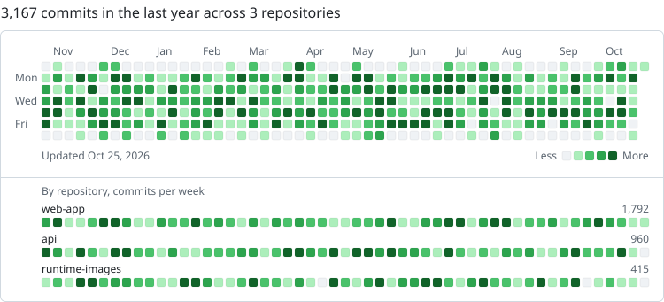

# Org Activity Graph

GitHub draws a contribution graph for people, not for organizations. This action draws one for a whole organization: every commit on the default branch of its repositories over the last year, in the same grid, colors and layout as a profile graph. Put it on your organization's profile page and visitors see the team's rhythm at a glance.

<a href="https://raw.githubusercontent.com/JulioMCruz/org-activity-graph/main/docs/example.svg">
<picture>
  <source media="(prefers-color-scheme: dark)" srcset="docs/example-dark.svg">
  
</picture>
</a>

Click the graph, then hover a square to see its count.

## What you get

- A dark and a light SVG, so the graph follows each visitor's theme.
- The header GitHub uses: "3,850 commits in the last year across 57 repositories".
- Optional weekly strips for the repositories you pick, to show where the work happens.
- Bots left out: any account ending in `[bot]`, plus logins you list.
- A count on every square, such as "12 commits on Oct 3, 2026". GitHub shows README images as plain pictures, so hovering does nothing there. The README links to a third file, `activity.svg`, which follows the visitor's theme and shows the count when you hover a square.
- An optional reveal that lights up the year week by week when the graph loads. It is plain CSS, so it plays inside a README too.
- No dependencies. The action is plain Node 24 and calls the GitHub GraphQL API.

## Use it on your organization profile

Your organization's profile page is `profile/README.md` in its `.github` repository.

1. Add [`examples/activity-graph.yml`](examples/activity-graph.yml) as `.github/workflows/activity-graph.yml` in that repository and set `org`. It redraws the graph daily and publishes the SVGs to an `activity` branch, so `main` stays free of daily commits.
2. Run the workflow once from the Actions tab.
3. Add this to `profile/README.md`, replacing `your-org`:

```html
<a href="https://raw.githubusercontent.com/your-org/.github/activity/activity.svg">
<picture>
  <source media="(prefers-color-scheme: dark)" srcset="https://raw.githubusercontent.com/your-org/.github/activity/activity-dark.svg">
  
</picture>
</a>
```

## Inputs

| Input | Default | What it does |
|---|---|---|
| `org` | required | Organization login. |
| `token` | `github.token` | Token used to read repositories and commits. The default token reads public repositories. |
| `output-dir` | `dist` | Folder for the SVG files. |
| `file-name` | `activity` | Writes `<file-name>-dark.svg`, `<file-name>-light.svg` and `<file-name>.svg`, which follows the viewer's theme. |
| `repos` | empty | Comma-separated public repositories that get a weekly strip, in this order. |
| `include-private` | `false` | Count private repositories the token can read. They only add to the daily totals; their names never appear. |
| `private-strip` | `false` | Add one strip named "Private repositories" with the combined weekly commits of every private repository, without naming any of them. Needs `include-private`. |
| `include-forks` | `false` | Count forked repositories. |
| `include-archived` | `false` | Count archived repositories. |
| `exclude-authors` | empty | Comma-separated logins or author names to leave out. |
| `exclude-repos` | empty | Comma-separated repositories to leave out, such as a copy of an outside project that brought its whole history along. |
| `palette` | `github` | `github` greens, `ember`, a pink-to-ember ramp, or `seasonal`, which follows the calendar. See [Seasons](#seasons). |
| `animate` | `false` | Light up the squares week by week when the graph loads. They wait dimmed, so every square stays readable. It plays once per load, and viewers who prefer reduced motion see the finished graph. |
| `colors-dark`, `colors-light` | empty | Five hex colors each, from no activity to most, to use your own palette. |
| `timezone` | `UTC` | IANA time zone for grouping commits by day. |
| `title` | `{commits} commits in the last year across {repos} repositories` | Header text. |

Outputs: `total-commits` and `repositories`.

## Seasons

Set `palette: seasonal` and the graph changes color with the date, in your `timezone`. The next scheduled run after the date changes picks up the new colors, with nothing else to do. The dates follow the northern hemisphere.

| Dates | Palette | Colors |
|---|---|---|
| Dec 1 to Feb 29 | `winter` | GitHub's winter blues |
| Dec 18 to Dec 26 | `christmas` | Pine, holly berries and a gold star |
| Dec 27 to Jan 2 | `newyear` | Midnight and champagne |
| Mar 1 to May 31 | `spring` | Cherry blossom |
| Jun 1 to Aug 31 | `summer` | Warm sea |
| Sep 1 to Nov 30 | `autumn` | Maple leaves |
| Oct 25 to Oct 31 | `halloween` | Pumpkin glow |

Holidays take over from the season around them. To keep one look all year, use its name as the `palette`.

## Private repositories

The default token of a workflow can only read public repositories, so out of the box the graph counts public work. To count private work too, create a fine-grained token with read access to the organization's repository contents and metadata, store it as a secret, and pass it with `include-private: true`. Private repositories then add to the daily squares and the totals. They never get a strip of their own or appear by name. To show private work on its own row, set `private-strip: true`: it adds one strip, "Private repositories", with their combined weekly commits.

Workflow inputs show up in the run's log, and the logs of a public repository are public. To leave out a private repository without naming it there, pass `exclude-repos` from a secret too: `exclude-repos: ${{ secrets.ORG_ACTIVITY_EXCLUDE_REPOS }}`.

## How commits are counted

- Commits on each repository's default branch, by commit date, over the last 53 weeks.
- A squash merge counts once; a merge commit and the commits it brings each count.
- A commit that lives in several repositories, such as a mirror or a copy, counts once in the totals. Each strip still shows every commit on its own repository.
- Shades follow the quartiles of the active days, the way GitHub shades a profile graph, so the busiest quarter of days is the darkest.
- Repositories with no push in the last year are skipped without reading their history.

## Develop

```bash
npm test
node scripts/render-example.mjs
```

To try it against a real organization from your machine:

```bash
env INPUT_ORG=your-org INPUT_TOKEN="$(gh auth token)" "INPUT_OUTPUT-DIR=out" node src/index.mjs
```

## License

MIT, see [LICENSE](LICENSE).
