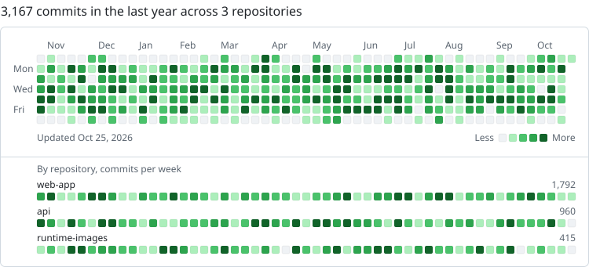

# Org Activity Graph

GitHub draws a contribution graph for people, not for organizations. This action draws one for a whole organization: every commit on the default branch of its repositories over the last year, in the same grid, colors and layout as a profile graph. Put it on your organization's profile page and visitors see the team's rhythm at a glance.

<picture>
  <source media="(prefers-color-scheme: dark)" srcset="docs/example-dark.svg">
  
</picture>

## What you get

- A dark and a light SVG, so the graph follows each visitor's theme.
- The header GitHub uses: "3,850 commits in the last year across 57 repositories".
- Optional weekly strips for the repositories you pick, to show where the work happens.
- Bots left out: any account ending in `[bot]`, plus logins you list.
- No dependencies. The action is plain Node 24 and calls the GitHub GraphQL API.

## Use it on your organization profile

Your organization's profile page is `profile/README.md` in its `.github` repository.

1. Add [`examples/activity-graph.yml`](examples/activity-graph.yml) as `.github/workflows/activity-graph.yml` in that repository and set `org`. It redraws the graph daily and publishes the SVGs to an `activity` branch, so `main` stays free of daily commits.
2. Run the workflow once from the Actions tab.
3. Add this to `profile/README.md`, replacing `your-org`:

```html
<picture>
  <source media="(prefers-color-scheme: dark)" srcset="https://raw.githubusercontent.com/your-org/.github/activity/activity-dark.svg">
  
</picture>
```

## Inputs

| Input | Default | What it does |
|---|---|---|
| `org` | required | Organization login. |
| `token` | `github.token` | Token used to read repositories and commits. The default token reads public repositories. |
| `output-dir` | `dist` | Folder for the SVG files. |
| `file-name` | `activity` | Writes `<file-name>-dark.svg` and `<file-name>-light.svg`. |
| `repos` | empty | Comma-separated public repositories that get a weekly strip, in this order. |
| `include-private` | `false` | Count private repositories the token can read. They only add to the daily totals; their names never appear. |
| `include-forks` | `false` | Count forked repositories. |
| `include-archived` | `false` | Count archived repositories. |
| `exclude-authors` | empty | Comma-separated logins or author names to leave out. |
| `palette` | `github` | `github` greens or `ember`, a pink-to-ember ramp. |
| `colors-dark`, `colors-light` | empty | Five hex colors each, from no activity to most, to use your own palette. |
| `timezone` | `UTC` | IANA time zone for grouping commits by day. |
| `title` | `{commits} commits in the last year across {repos} repositories` | Header text. |

Outputs: `total-commits` and `repositories`.

## Private repositories

The default token of a workflow can only read public repositories, so out of the box the graph counts public work. To count private work too, create a fine-grained token with read access to the organization's repository contents and metadata, store it as a secret, and pass it with `include-private: true`. Private repositories then add to the daily squares and the totals. They never get a strip or appear by name.

## How commits are counted

- Commits on each repository's default branch, by commit date, over the last 53 weeks.
- A squash merge counts once; a merge commit and the commits it brings each count.
- Shades follow the quartiles of the active days, the way GitHub shades a profile graph, so the busiest quarter of days is the darkest.
- Repositories with no push in the last year are skipped without reading their history.

## Develop

```bash
npm test
node scripts/render-example.mjs
```

To try it against a real organization from your machine:

```bash
env INPUT_ORG=your-org INPUT_TOKEN="$(gh auth token)" "INPUT_OUTPUT-DIR=out" node src/index.mjs
```

## License

MIT, see [LICENSE](LICENSE).
