# Seasonal Activity Graph

Your GitHub contribution graph, with colors and decoration that follow the calendar: falling leaves in autumn, snow in winter, pumpkins at Halloween and fireworks at New Year. It lights up week by week when your README loads.

It also draws what GitHub does not: one graph for a whole organization, with every commit on the default branch of its repositories over the last year, in the same grid and layout as a profile graph.



## Quick start

1. Add this file as `.github/workflows/activity-graph.yml`. For a personal profile it goes in your `username/username` repository, and for an organization in its `.github` repository. Both must be public.

   ```yaml
   name: Activity graph

   on:
     schedule:
       - cron: "17 6 * * *"
     workflow_dispatch:
     push:
       paths:
         - .github/workflows/activity-graph.yml

   permissions:
     contents: write

   jobs:
     graph:
       runs-on: ubuntu-latest
       steps:
         - uses: JulioMCruz/org-activity-graph@v1
           with:
             publish: true
             palette: seasonal
             animate: true
             effects: true
   ```

   Or run this from a clone of that repository:

   ```bash
   curl -fsSL https://raw.githubusercontent.com/JulioMCruz/org-activity-graph/v1/examples/quickstart.yml --create-dirs -o .github/workflows/activity-graph.yml
   ```

2. Commit it. The graph draws itself, in a few seconds for a person and a minute or two for a large organization. There is nothing to edit: the action uses the owner of the repository.
3. Open the run in the Actions tab. Its summary has the exact lines to paste into your README.

That's it. The graph updates every day and changes with the season on its own.

## What you get

- A personal profile or a whole organization, picked from the repository that runs the action.
- Colors and decoration for seven seasons and holidays. See [Seasons](#seasons).
- A dark and a light SVG, so the graph follows each visitor's theme.
- The header GitHub uses: "3,850 commits in the last year across 57 repositories".
- For an organization, optional weekly strips for the repositories you pick, to show where the work happens.
- Bots left out: any account ending in `[bot]`, plus logins you list.
- A count on every square, such as "12 commits on Oct 3, 2026". GitHub shows README images as plain pictures, so hovering does nothing there. The README links to a third file, `activity.svg`, which follows the visitor's theme and shows the count when you hover a square.
- An optional reveal that lights up the year week by week when the graph loads. It is plain CSS, so it plays inside a README too.
- Optional seasonal effects: snow, falling leaves, pumpkins, fireworks and more, in plain SVG and CSS.
- No dependencies. The action is plain Node 24 and calls the GitHub GraphQL API.

## Personal profiles

A personal graph comes from GitHub's own contribution calendar, so its total and shades match your profile. The default token is enough, and the graph shows what your public profile shows.

Your profile page is `README.md` in your `username/username` repository.

## Organizations

An organization's profile page is `profile/README.md` in its `.github` repository. The quick start counts its public repositories. Set `repos` to add a weekly strip for the repositories you pick, and see [Private repositories](#private-repositories) to count private work too. Every option is in [`examples/activity-graph.yml`](examples/activity-graph.yml).

<a href="https://raw.githubusercontent.com/JulioMCruz/org-activity-graph/main/docs/example.svg">
<picture>
  <source media="(prefers-color-scheme: dark)" srcset="docs/example-dark.svg">
  
</picture>
</a>

Click the graph, then hover a square to see its count.

## Add the graph by hand

The run's summary gives you these lines with your repository already in place. To write them yourself, replace `your-org/.github` with your repository:

```html
<a href="https://raw.githubusercontent.com/your-org/.github/activity/activity.svg">
<picture>
  <source media="(prefers-color-scheme: dark)" srcset="https://raw.githubusercontent.com/your-org/.github/activity/activity-dark.svg">
  
</picture>
</a>
```

## Inputs

| Input | Default | What it does |
|---|---|---|
| `org` | the repository owner | User or organization login. |
| `token` | `github.token` | Token used to read repositories and commits. The default token reads public repositories. |
| `publish` | `false` | Publish the SVG files to a branch of this repository, so a README can show them. Needs `contents: write`. |
| `publish-branch` | `activity` | Branch that receives the files. It keeps a single commit, so `main` stays free of daily commits. |
| `publish-token` | `github.token` | Token used to publish, separate from `token`, which only needs to read. |
| `output-dir` | `dist` | Folder for the SVG files. |
| `file-name` | `activity` | Writes `<file-name>-dark.svg`, `<file-name>-light.svg` and `<file-name>.svg`, which follows the viewer's theme. |
| `repos` | empty | Comma-separated public repositories that get a weekly strip, in this order. |
| `include-private` | `false` | Count private repositories the token can read. They only add to the daily totals; their names never appear. |
| `private-strip` | `false` | Add one strip named "Private repositories" with the combined weekly commits of every private repository, without naming any of them. Needs `include-private`. |
| `include-forks` | `false` | Count forked repositories. |
| `include-archived` | `false` | Count archived repositories. |
| `exclude-authors` | empty | Comma-separated logins or author names to leave out. |
| `exclude-repos` | empty | Comma-separated repositories to leave out, such as a copy of an outside project that brought its whole history along. |
| `palette` | `github` | `github` greens, `ember`, a pink-to-ember ramp, or `seasonal`, which follows the calendar. See [Seasons](#seasons). |
| `animate` | `false` | Light up the squares week by week when the graph loads. They wait dimmed, so every square stays readable. It plays once per load, and viewers who prefer reduced motion see the finished graph. |
| `effects` | `false` | Add the season's decoration, for the seasonal palettes. See [Seasons](#seasons). |
| `colors-dark`, `colors-light` | empty | Five hex colors each, from no activity to most, to use your own palette. |
| `timezone` | `UTC` | IANA time zone for grouping commits by day. |
| `title` | `{commits} commits in the last year across {repos} repositories`, or `{contributions} contributions in the last year` for a person | Header text. |

Outputs: `total-commits` and `repositories`.

On a personal profile `repos`, `include-private`, `private-strip`, `include-forks`, `include-archived`, `exclude-authors` and `exclude-repos` do nothing, and the run says so.

## Seasons

<table>
<tr>
<td align="center"><br>Autumn</td>
<td align="center"><br>Halloween</td>
</tr>
<tr>
<td align="center"><br>Winter</td>
<td align="center"><br>Christmas</td>
</tr>
<tr>
<td align="center"><br>New Year</td>
<td align="center"><br>Spring</td>
</tr>
<tr>
<td align="center"><br>Summer</td>
<td></td>
</tr>
</table>

Set `palette: seasonal` and the graph changes color with the date, in your `timezone`. The next scheduled run after the date changes picks up the new colors, with nothing else to do. The dates follow the northern hemisphere.

| Dates | Palette | Colors |
|---|---|---|
| Dec 1 to Feb 29 | `winter` | GitHub's winter blues |
| Dec 18 to Dec 26 | `christmas` | Pine, holly berries and a gold star |
| Dec 27 to Jan 2 | `newyear` | Midnight and champagne |
| Mar 1 to May 31 | `spring` | Cherry blossom |
| Jun 1 to Aug 31 | `summer` | Warm sea |
| Sep 1 to Nov 30 | `autumn` | Maple leaves |
| Oct 25 to Oct 31 | `halloween` | Pumpkin glow |

Holidays take over from the season around them. To keep one look all year, use its name as the `palette`.

Set `effects: true` to dress the graph for the season:

| Palette | When the graph loads | Stays on the graph |
|---|---|---|
| `winter` | Snowfall | Snow on the frame and a snowman |
| `christmas` | Snowfall | String lights and a tree |
| `newyear` | Fireworks and confetti | Champagne and sparkles |
| `spring` | Cherry petals | A branch in bloom |
| `summer` | Rising bubbles | Sun, waves and a sailboat |
| `autumn` | Falling maple leaves | A pile of leaves |
| `halloween` | Bats | Lit pumpkins around the graph |

Everything in motion leaves the frame when it finishes, and the pieces that stay sit in the empty bands around the squares, so every count stays readable. Viewers who prefer reduced motion see only the pieces that stay.

## Private repositories

The default token of a workflow can only read an organization's public repositories, so out of the box the graph counts public work. To count private work too, create a fine-grained token with read access to the organization's repository contents and metadata, store it as a secret, and pass it with `include-private: true`. Private repositories then add to the daily squares and the totals. They never get a strip of their own or appear by name. To show private work on its own row, set `private-strip: true`: it adds one strip, "Private repositories", with their combined weekly commits.

Workflow inputs show up in the run's log, and the logs of a public repository are public. To leave out a private repository without naming it there, pass `exclude-repos` from a secret too: `exclude-repos: ${{ secrets.ORG_ACTIVITY_EXCLUDE_REPOS }}`.

## Keep it running

GitHub pauses scheduled workflows in a public repository after 60 days without activity there. The date under the graph shows the last update. If it stops, press Enable workflow in the Actions tab, or make a commit on the repository's default branch before the 60 days are up.

## How commits are counted

For an organization:

- Commits on each repository's default branch, by commit date, over the last 53 weeks.
- A squash merge counts once; a merge commit and the commits it brings each count.
- A commit that lives in several repositories, such as a mirror or a copy, counts once in the totals. Each strip still shows every commit on its own repository.
- Shades follow the quartiles of the active days, so the busiest quarter of days is the darkest.
- Repositories with no push in the last year are skipped without reading their history.

## Develop

```bash
npm test
node scripts/render-example.mjs
```

To try it against a real organization from your machine:

```bash
env INPUT_ORG=your-org INPUT_TOKEN="$(gh auth token)" "INPUT_OUTPUT-DIR=out" node src/index.mjs
```

## License

MIT, see [LICENSE](LICENSE).
